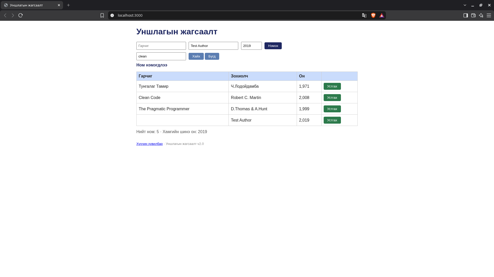
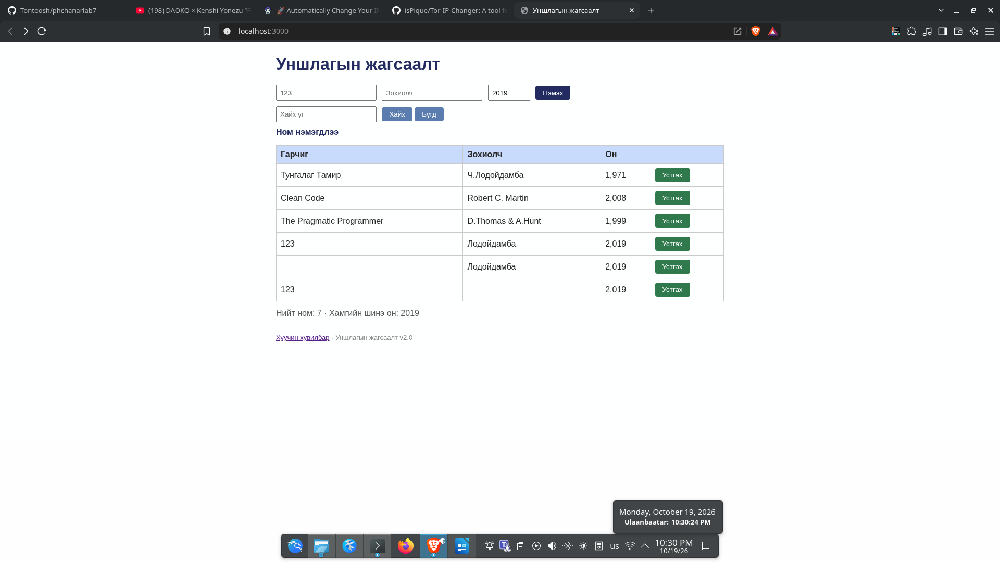
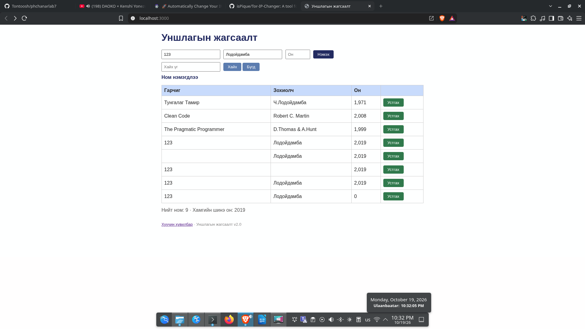

# BUG-02: Заавал бөглөх талбар хоосон байхад ном нэмэгдэнэ

Орчин: Уншлагын жагсаалт v2.0; Brave Browser 152.1.94.121 (Chromium суурьтай); Kali GNU/Linux 2026.1; Node.js v24.15.0; 2026-10-19.

Урьдчилсан нөхцөл: `node app.js`-ийг шинээр асаасан, анхны 3 номтой. Серверийг Ctrl+C-ээр зогсоож дахин асаахад өгөгдөл анхны төлөвт орно.

## Дахин гаргах алхам

1. `http://localhost:3000` нээнэ.
2. Гарчгийг хоосон, зохиолчийг `Test Author`, оныг `2019` болгоно.
3. «Нэмэх» товч дарж хүснэгт, мессежийг ажиглана.

Хүлээгдэж байсан: Гарчиг, зохиолч, он бүгд заавал; дутуу бол нэмэхгүй, ойлгомжтой алдаа харуулна.

Бодит үр дүн: Хоосон гарчигтай мөр нэмэгдэж, «Ном нэмэгдлээ» гэж харагдсан. Нэмэлт зурагт зохиолч хоосон мөр, он хоосон үед 0 болсон мөр байна; эдгээрийг шаардлагатай талбарын нэг согогийн хувилбар болгон нэгтгэв.

Ноцтой байдал: Major — дутуу мэдээлэлтэй ном хадгалах боломжтой.

Олдсон аялал: Couch Potato.

## Нотолгоо

Баталгаажуулалт: 2026-10-19-ний 23:04–23:09 (+08)-д аппыг шинээр асаасан төлөвөөс Brave дээр UI үйлдлээр дахин шалгасан. Шинэ хавсралт нь тухайн дахин шалгалтын бодит screenshot. [Түүхий тэмдэглэл](../evidence/verification-notes.md).

