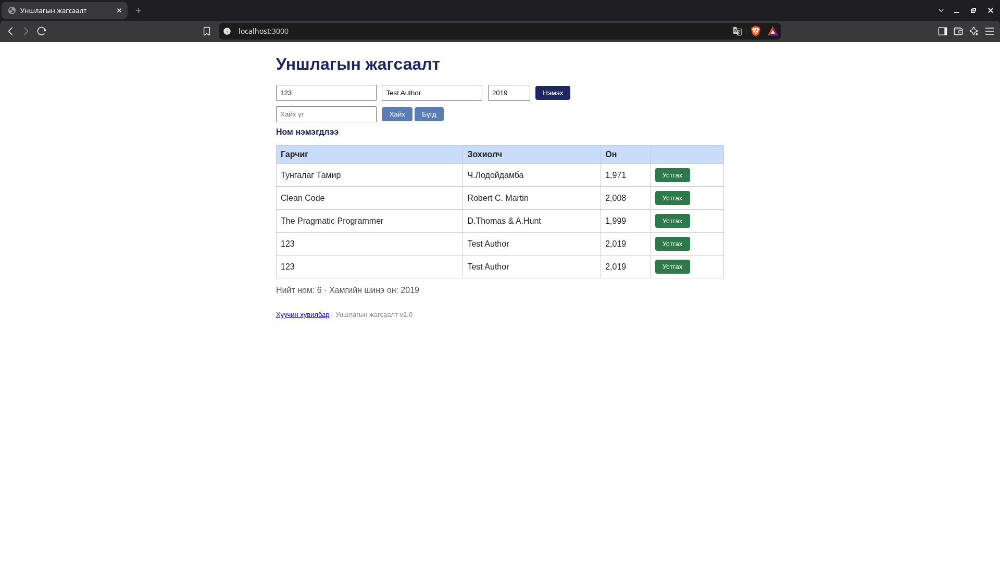

# BUG-03: Ижил гарчиг, зохиолчтой ном давхар нэмэгдэнэ

Орчин: Уншлагын жагсаалт v2.0; Brave Browser 152.1.94.121 (Chromium суурьтай); Kali GNU/Linux 2026.1; Node.js v24.15.0; 2026-10-19.

Урьдчилсан нөхцөл: `node app.js`-ийг шинээр асаасан, анхны 3 номтой. Серверийг Ctrl+C-ээр зогсоож дахин асаахад өгөгдөл анхны төлөвт орно.

## Дахин гаргах алхам

1. `http://localhost:3000` нээнэ.
2. Гарчиг `123`, зохиолч `Test Author`, он `2019` оруулаад «Нэмэх» дарна.
3. Талбаруудын утгыг ижил байлгаж «Нэмэх» дахин дарна.
4. Ижил мэдээлэлтэй мөрүүдийг ажиглана.

Хүлээгдэж байсан: Ижил гарчиг, зохиолчтой номыг хоёр дахь удаа нэмэхгүй.

Бодит үр дүн: Шинэ зурагт `123 / Test Author / 2,019` мэдээлэлтэй хоёр мөр байна. Анхны session-ийн зурагт зохиолч нь Лодойдамба байсан; дахин шалгалтад Test Author ашиглахад ижил үр дүн гарсан.

Ноцтой байдал: Major — давхардсан өгөгдөл бүртгэгдэж байна.

Олдсон аялал: Fed-Ex.

## Нотолгоо

Баталгаажуулалт: 2026-10-19-ний 23:04–23:09 (+08)-д аппыг шинээр асаасан төлөвөөс Brave дээр UI үйлдлээр дахин шалгасан. Шинэ хавсралт нь тухайн дахин шалгалтын бодит screenshot. [Түүхий тэмдэглэл](../evidence/verification-notes.md).

