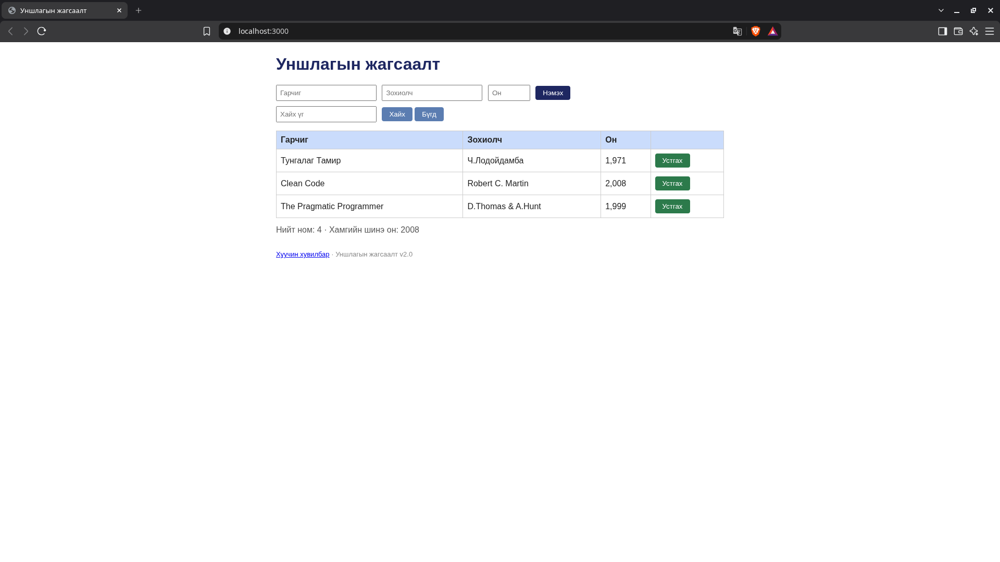

# BUG-04: Хүснэгтийн оныг мянгатын таслалтай харуулна

Орчин: Уншлагын жагсаалт v2.0; Brave Browser 152.1.94.121 (Chromium суурьтай); Kali GNU/Linux 2026.1; Node.js v24.15.0; 2026-10-19.

Урьдчилсан нөхцөл: `node app.js`-ийг шинээр асаасан, анхны 3 номтой. Серверийг Ctrl+C-ээр зогсоож дахин асаахад өгөгдөл анхны төлөвт орно.

## Дахин гаргах алхам

1. `http://localhost:3000` нээнэ.
2. Анхны 3 номын «Он» баганыг уншина.

Хүлээгдэж байсан: Он энгийн тоогоор, тухайлбал 1971, 2008, 1999 гэж харагдана.

Бодит үр дүн: Он баганад `1,971`, `2,008`, `1,999` гэж харагдана. BUG-04-ийн түүхий тэмдэглэл дэх хоосон он 0 болох хувилбарыг BUG-02-т нэгтгэсэн; энд зөвхөн оны дүрслэлийг тайлагнав.

Ноцтой байдал: Cosmetic — оны харагдах формат спецификацитай зөрж байна.

Олдсон аялал: Supermodel.

## Нотолгоо

Баталгаажуулалт: 2026-10-19-ний 23:04–23:09 (+08)-д аппыг шинээр асаасан төлөвөөс Brave дээр UI үйлдлээр дахин шалгасан. Шинэ хавсралт нь тухайн дахин шалгалтын бодит screenshot. [Түүхий тэмдэглэл](../evidence/verification-notes.md).

