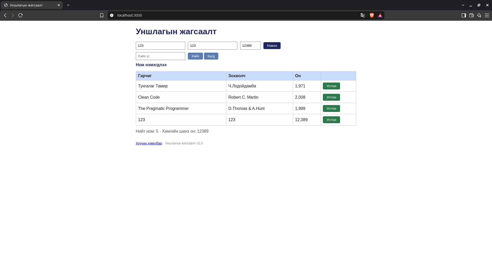

# BUG-06: Зөвшөөрсөн 1000–2100 мужаас гадуурх онтой ном нэмэгдэнэ

Орчин: Уншлагын жагсаалт v2.0; Brave Browser 152.1.94.121 (Chromium суурьтай); Kali GNU/Linux 2026.1; Node.js v24.15.0; 2026-10-19.

Урьдчилсан нөхцөл: `node app.js`-ийг шинээр асаасан, анхны 3 номтой. Серверийг Ctrl+C-ээр зогсоож дахин асаахад өгөгдөл анхны төлөвт орно.

## Дахин гаргах алхам

1. `http://localhost:3000` нээнэ.
2. Гарчиг `123`, зохиолч `123`, он `12389` оруулна.
3. «Нэмэх» дарж хүснэгтийн шинэ мөрийг шалгана.

Хүлээгдэж байсан: Он 1000–2100 хоорондох бүхэл тоо байна; 12389 утгыг хүлээн авахгүй.

Бодит үр дүн: Зурагт `123 / 123 / 12,389` мөр нэмэгдэж, хамгийн шинэ он 12389 гэж харагдана. Мөн 123 онтой мөр байна.

Ноцтой байдал: Major — хүчингүй он өгөгдөлд орж байна.

Олдсон аялал: Fed-Ex.

## Нотолгоо

Баталгаажуулалт: 2026-10-19-ний 23:04–23:09 (+08)-д аппыг шинээр асаасан төлөвөөс Brave дээр UI үйлдлээр дахин шалгасан. Шинэ хавсралт нь тухайн дахин шалгалтын бодит screenshot. [Түүхий тэмдэглэл](../evidence/verification-notes.md).

