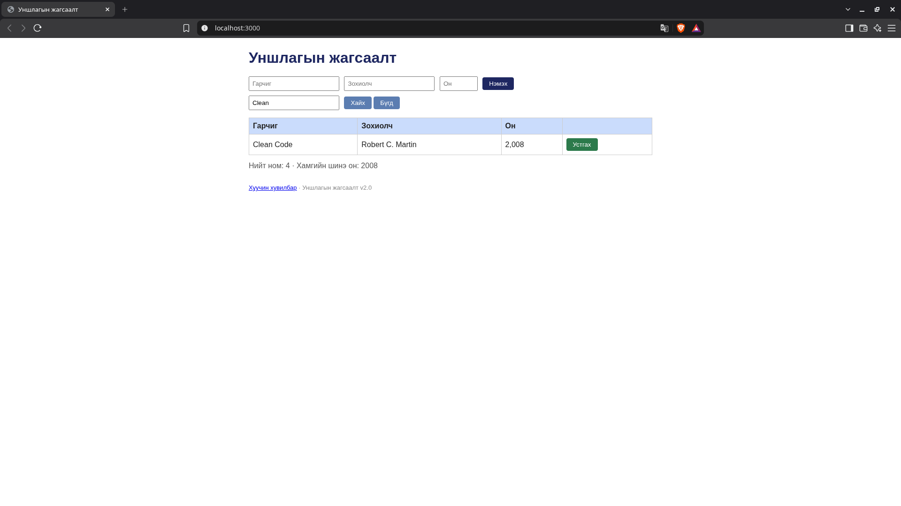
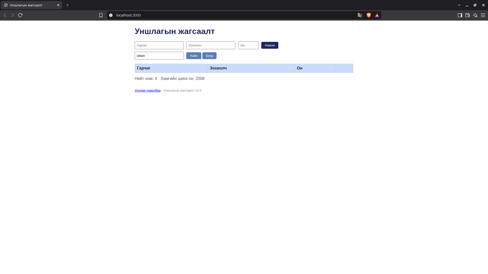

# BUG-07: Гарчгийн хайлт том/жижиг үсэг ялгаж байна

Орчин: Уншлагын жагсаалт v2.0; Brave Browser 152.1.94.121; Kali GNU/Linux 2026.1; Node.js v24.15.0; 2026-10-19.

Урьдчилсан нөхцөл: node app.js-ийг шинээр асаасан, анхны 3 номтой. Clean Code ном жагсаалтад байна.

## Дахин гаргах алхам

1. `http://localhost:3000` нээнэ.
2. «Хайх үг» талбарт `Clean` оруулаад «Хайх» дарна.
3. Clean Code ном нэг мөр харагдаж байгааг шалгана.
4. Ижил талбарын утгыг `clean` болгон сольж «Хайх» дахин дарна.
5. Хүснэгтийн үр дүнг харьцуулна.

Хүлээгдэж байсан: Спецификацийн дагуу хайлт том/жижиг үсэг ялгахгүй тул хоёр хайлт хоёулаа Clean Code номыг харуулна.

Бодит үр дүн: `Clean` хайлт нэг мөр харуулдаг, `clean` хайлтад хүснэгт хоосон болдог.

Ноцтой байдал: Major — байгаа номыг зөвхөн үсгийн хэмжээнээс шалтгаалж олж чадахгүй байна.

Олдсон аялал: Fed-Ex.

## Нотолгоо

Баталгаажуулалт: 2026-10-19 23:05:21–23:05:36 (+08), шинээр асаасан апп дээр Brave-ийн UI ашиглан харьцуулсан. [Түүхий тэмдэглэл](../evidence/verification-notes.md).

Анхны session-ийн Дамба хайлтын зураг үсгийн хэмжээний нөлөөг дангаараа батлахгүй байсан тул эцсийн алхмыг Clean/clean гэсэн тусгаарласан туршилтаар сольсон. Анхны түүхий тэмдэглэл session-report.md-д хэвээр байна.
