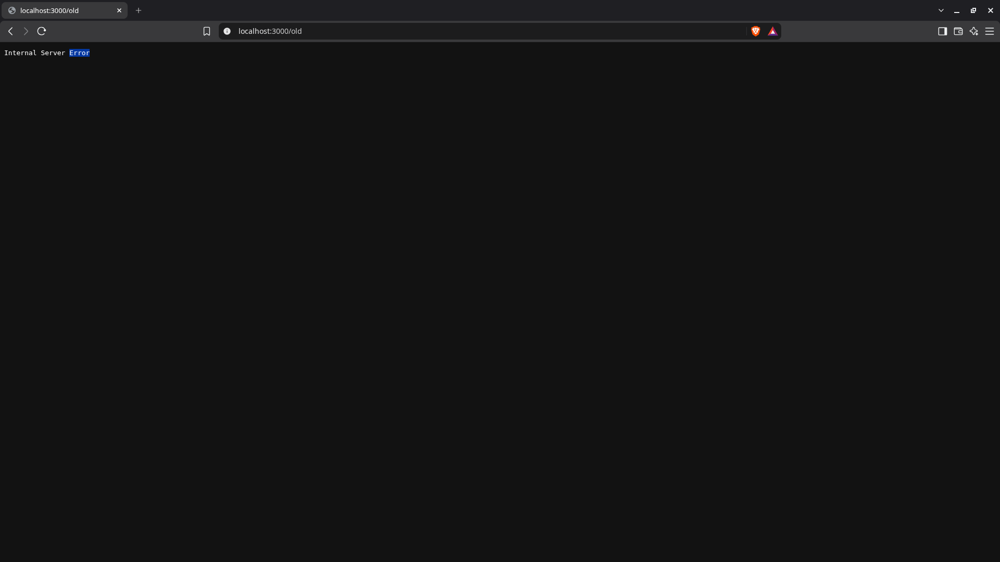

# BUG-08: «Хуучин хувилбар» холбоос Internal Server Error харуулна

Орчин: Уншлагын жагсаалт v2.0; Brave Browser 152.1.94.121 (Chromium суурьтай); Kali GNU/Linux 2026.1; Node.js v24.15.0; 2026-10-19.

Урьдчилсан нөхцөл: `node app.js`-ийг шинээр асаасан, анхны 3 номтой. Серверийг Ctrl+C-ээр зогсоож дахин асаахад өгөгдөл анхны төлөвт орно.

## Дахин гаргах алхам

1. `http://localhost:3000` нээнэ.
2. Хуудасны доорх «Хуучин хувилбар» холбоос дарна.
3. Хаяг `/old` болсны дараах хуудасны агуулгыг ажиглана.

Хүлээгдэж байсан: Спецификацийн дагуу бүх хуудас, холбоос ажиллана.

Бодит үр дүн: `http://localhost:3000/old` хуудас `Internal Server Error` текст харуулна. Дахин шалгалтын curl -i гаралт `HTTP/1.1 500 Internal Server Error` болохыг батлав: [HTTP нотолгоо](../evidence/bug-08-curl.txt).

Ноцтой байдал: Major — холбоосын зорилтот хуудас ашиглах боломжгүй.

Олдсон аялал: Supermodel.

## Нотолгоо

Баталгаажуулалт: 2026-10-19-ний 23:04–23:09 (+08)-д аппыг шинээр асаасан төлөвөөс Brave дээр UI үйлдлээр дахин шалгасан. Шинэ хавсралт нь тухайн дахин шалгалтын бодит screenshot. [Түүхий тэмдэглэл](../evidence/verification-notes.md).

