# Session report

Тестер: Б.Дөлгөөн (B242270136)
Огноо: 2026-10-19
Орчин: Kali GNU/Linux 2026.1; Brave Browser 152.1.94.121; Node.js v24.15.0
Mission: «Уншлагын жагсаалт» v2.0 аппын чанарыг шинжлэх.
Charter: [charter.md](charter.md) — Supermodel, Couch Potato, Fed-Ex, Saboteur аяллаар UI, оролтын шалгалт, өгөгдлийн урсгал, API-ийн зан төлөвийг шалгах.

## Session-ийн хугацаа

Эхэлсэн: 22:23:17 (UTC+08:00, Asia/Ulaanbaatar).
Дууссан: 23:23:17.
Нийт хугацаа: 60 минут (тестерийн мэдээлснээр).

Анхны туршилт болон серверийг шинээр асааж хийсэн verified давталтыг нэг session-ийн хүрээнд нэгтгэв. Session-ийн нийт хугацааг тестерийн мэдээллээр тэмдэглэсэн; зургийн болон HTTP нотолгооны бодит цагуудыг хэвээр хадгалав.

## Тэмдэглэл ба нотолгоо

22:23:17 — Session-ийн эхлэх цагийг тэмдэглэв.

Дараах хэсгүүдэд тухайн согогийн түүхий тэмдэглэл, зургийн цагт тулгуурласан ажиглалт, дахин шалгалтыг нэгтгэв. Түүхий тэмдэглэлийн үг, бичлэгийг code block дотор хэвээр хадгалсан. Зургийн цаг нь нотолгоо авсан цаг . UI согог бүрд анхны болон шинээр асаасан серверийн хоёр зураг хавсаргав; API согогт HTTP хариуны текст файлуудыг ашиглав.

## BUG-01 — Номын тоолуур хүснэгтийн мөрийн тоотой зөрнө

Түүхий тэмдэглэл:

```text
niit nom 4 haragdaj bui nom 3
```

**22:25:20, анхны ажиглалт:** Хүснэгтэд 3 ном байхад «Нийт ном: 4» гэж харагдсан. Хүлээгдсэн нь 3; тоолуур хүснэгтийн номын тоотой тэнцүү байх ёстой. Аялал: Fed-Ex.

**Дахин шалгалт:** Шинэ clone хавтаснаас Node серверийг шинээр асааж, анхны 3 номтой төлөвт ижил зөрүүг баталсан. Бүртгэл: 23:12:46. [Дэлгэрэнгүй тайлан](bugs/bug-01.md).

Анхны зураг:


Серверийг шинээр асаасны дараах зураг:

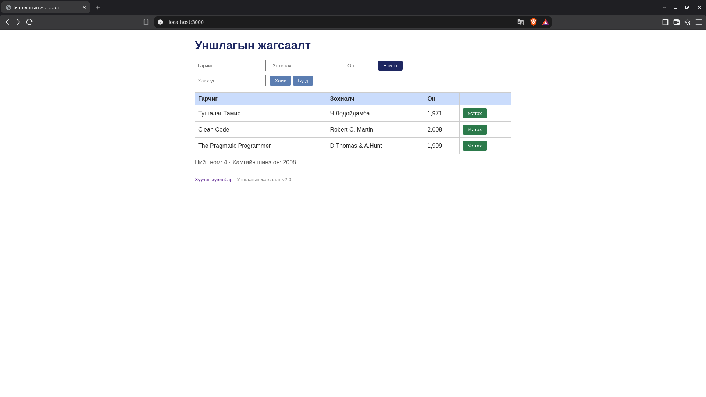

## BUG-02 — Заавал бөглөх талбар хоосон байхад ном нэмэгдэнэ

Түүхий тэмдэглэл:

```text
garchig hooson ued aldaa zaahgui nemegdej orson
```

**22:27:57, анхны ажиглалт:** Гарчгийг хоосон үлдээн ном нэмэхэд хоосон гарчигтай мөр үүсэж, «Ном нэмэгдлээ» мессеж гарсан. Хүлээгдсэн нь ном нэмэхгүй, ойлгомжтой алдаа харуулах. Аялал: Couch Potato.

**Холбоотой хувилбарууд:** 22:30:24-д зохиолч хоосон мөр, 22:32:05-д он хоосон үед 0 онтой мөр үүссэн. Эдгээр нь заавал бөглөх талбарын нэг согогийн хувилбарууд тул тусдаа согог болгон тоолоогүй. [Зохиолч хоосон зураг](screenshots/bug-02-author.png), [он хоосон зураг](screenshots/bug-02-year.png).

**23:13:06, дахин шалгалт:** Шинээр асаасан сервер дээр гарчиг хоосон, зохиолч `Test Author`, он `2019` оруулж «Нэмэх» дарахад ижил согог гарсан. [Дэлгэрэнгүй тайлан](bugs/bug-02.md).

Анхны зураг:

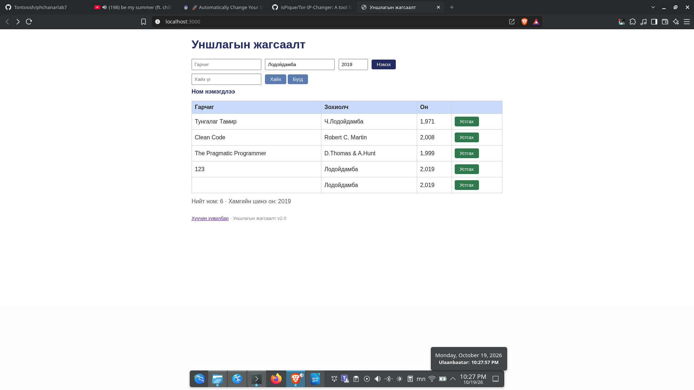

Серверийг шинээр асаасны дараах зураг:

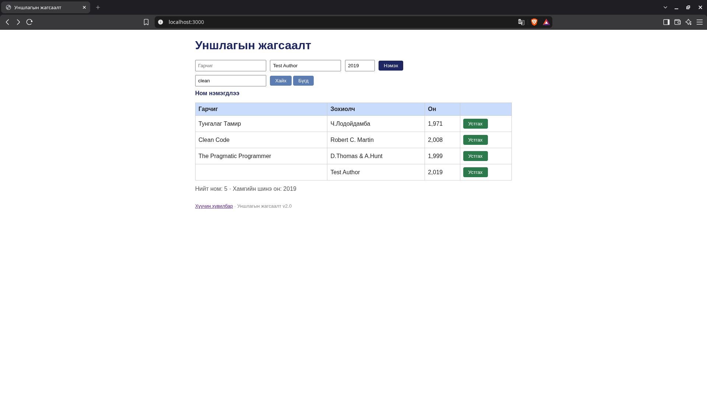

## BUG-03 — Ижил ном давхар нэмэгдэнэ

Түүхий тэмдэглэл:

```text
ijil data nom davhardaj orj bolj bsan

```

**22:31:18, анхны ажиглалт:** `123 / Лодойдамба / 2019` мэдээлэлтэй хоёр мөр үүссэн. Хүлээгдсэн нь ижил гарчиг, зохиолчтой номыг давхар нэмэхгүй байх. Аялал: Fed-Ex.

**23:13:50, дахин шалгалт:** Серверийг шинээр асаасны дараа `123 / Test Author / 2019` утгатай номыг хоёр удаа нэмэхэд мөн хоёр ижил мөр үүссэн. Зохиолчийн нэрийг сольсон ч давхардлын асуудал давтагдсан. [Дэлгэрэнгүй тайлан](bugs/bug-03.md).

Анхны зураг:

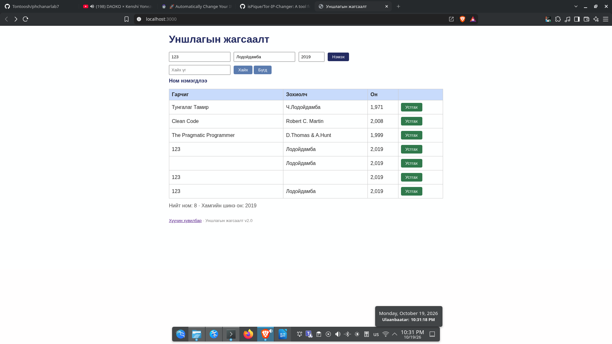

Серверийг шинээр асаасны дараах зураг:

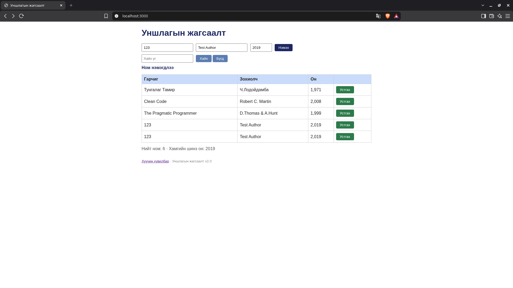

## BUG-04 — Оныг энгийн тооны оронд мянгатын таслалтай харуулна

Түүхий тэмдэглэл:

```text
oniig hooson oruulhad 0 r shuud utag avj bn tegeed ene onoor bish shuud toon utguud avj bgaa tul year format bhgui
```

**22:25:20, дүрслэлийн нотолгоо:** Анхны 3 номын он `1,971`, `2,008`, `1,999` гэж харагдсан. Спецификацийн дагуу `1971`, `2008`, `1999` гэсэн энгийн тоо байх ёстой. Аялал: Supermodel.

Түүхий тэмдэглэл хоёр асуудлыг хамтад нь дурдсан тул хоосон он 0 болох хувилбарыг BUG-02-т, оны харагдах форматыг BUG-04-т ялгаж баримтжуулсан.

**Дахин шалгалт:** Шинэ серверийн анхны төлөвт онууд мөн таслалтай харагдсан; 23:12:46-ийн бүртгэлд баталгаажуулсан. [Дэлгэрэнгүй тайлан](bugs/bug-04.md).

Анхны зураг:

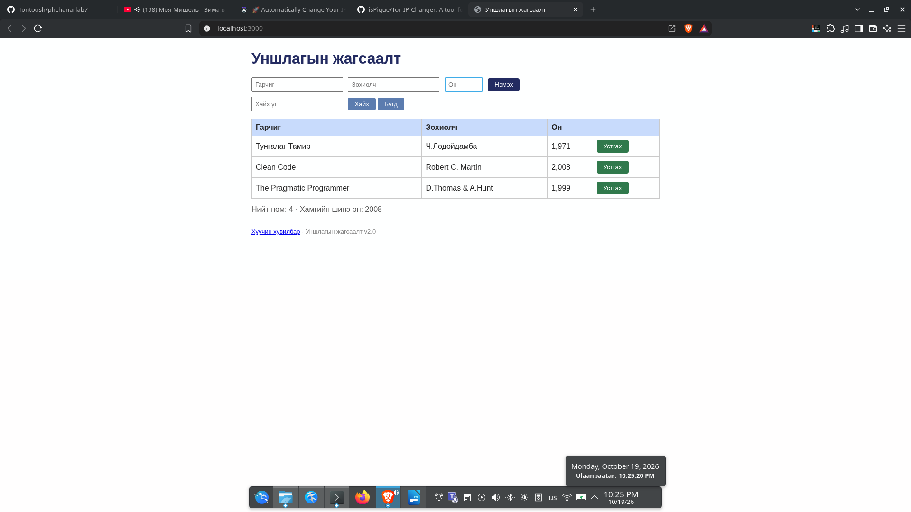

Серверийг шинээр асаасны дараах зураг:


## BUG-05 — «Устгах» товч ногоон өнгөтэй

Түүхий тэмдэглэл:

```text
ustgah tovch nogoon ungutei

```

**22:25:20, анхны нотолгоо:** Номын мөрүүдийн «Устгах» товч ногоон өнгөтэй байсан. Спецификацийн дагуу аюултай үйлдлийн товч улаан байх ёстой. Аялал: Supermodel.

**Дахин шалгалт:** Шинэ серверийн анхны 3 номын устгах товч бүгд ногоон хэвээр; 23:12:46-ийн бүртгэлд баталгаажуулсан. [Дэлгэрэнгүй тайлан](bugs/bug-05.md).

Анхны зураг:


Серверийг шинээр асаасны дараах зураг:


## BUG-06 — Оны зөвшөөрөгдөх мужийг шалгахгүй

Түүхий тэмдэглэл:

```text
toonii hyazgaarlalt bhgui
```

**22:33:40, анхны ажиглалт:** Он `123` болон `12389` утгатай номууд нэмэгдсэн. Хүлээгдсэн нь оныг 1000–2100 хоорондох бүхэл тоогоор хязгаарлах. Аялал: Fed-Ex.

**23:14:15, дахин шалгалт:** Серверийг шинээр асаагаад `123 / 123 / 12389` утгаар нэмэхэд `12,389` онтой мөр үүссэн. [Дэлгэрэнгүй тайлан](bugs/bug-06.md).

Анхны зураг:

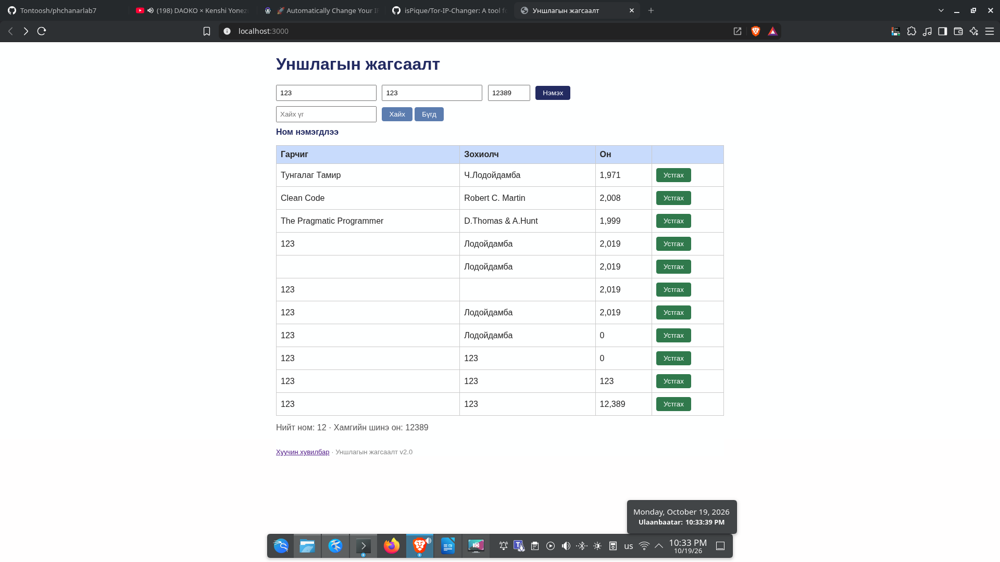

Серверийг шинээр асаасны дараах зураг:

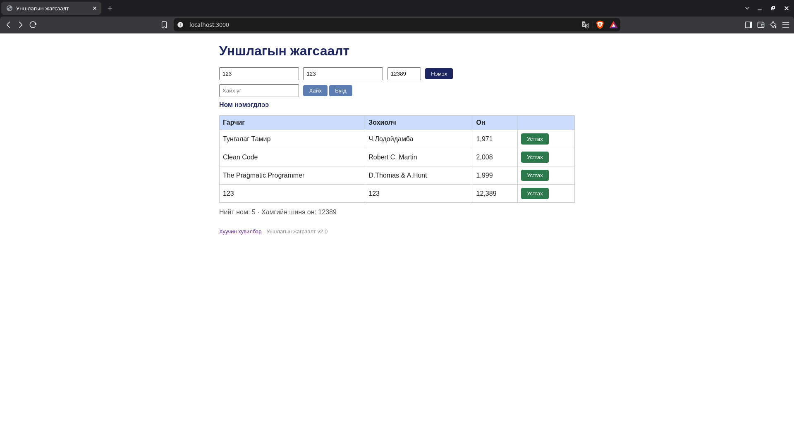

## BUG-07 — Хайлт том/жижиг үсэг ялгана

Түүхий тэмдэглэл:

```text
tom jijig useg ylgaj tanidag
```

**22:37:03, анхны ажиглалт:** `Дамба` хайлтад мөр харагдаагүй. Энэ зураг дангаараа үсгийн хэмжээний нөлөөг батлахгүй байсан тул тусгаарласан харьцуулалт хийсэн. Аялал: Fed-Ex.

**23:05:21–23:05:36, дахин шалгалт:** Анхны 3 номтой төлөвт `Clean` хайлт Clean Code номыг харуулж, `clean` хайлт үр дүнгүй болсон. Спецификацийн дагуу хоёр хайлт ижил үр дүнтэй байх ёстой.

**23:12:46, шинэ clone-ийн шалгалт:** Ижил харьцуулалтыг дахин хийхэд согог давтагдсан. Доорх шинэ зураг нь `clean` хайлтын үр дүн; [Clean хайлтаар ном олдсон харьцуулах зураг](screenshots/clone-search-Clean.png)-ийг мөн хадгалсан. [Дэлгэрэнгүй тайлан](bugs/bug-07.md).

Анхны зураг:

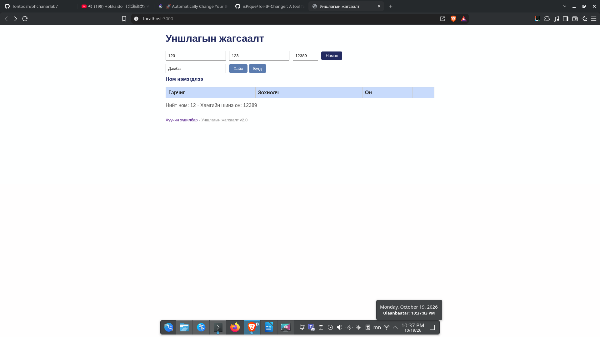

Серверийг шинээр асаасны дараах зураг:

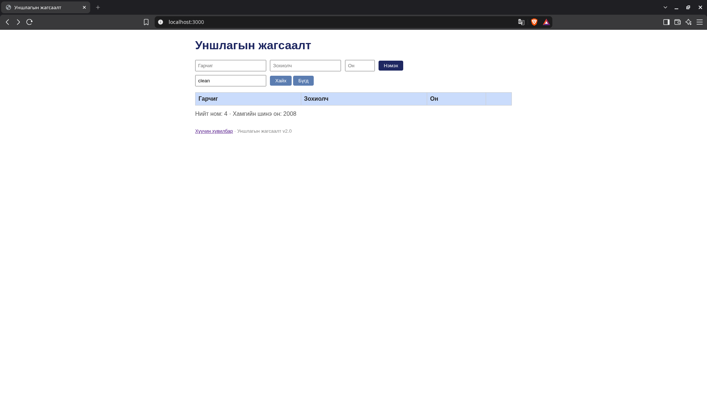

## BUG-08 — «Хуучин хувилбар» холбоос алдаатай хуудас нээнэ

Түүхий тэмдэглэл:

```text
holboos link ajilaagui
```

**22:38:26, анхны ажиглалт:** «Хуучин хувилбар» холбоосоор `/old` хуудас нээхэд `Internal Server Error` харагдсан. Спецификацийн дагуу бүх хуудас, холбоос ажиллах ёстой. Аялал: Supermodel.

**23:14:37, дахин шалгалт:** Шинээр асаасан сервер дээр холбоосыг дарахад мөн алдаатай хуудас нээгдсэн. [curl -i-ийн бүтэн хариу](evidence/clone-old-link-curl.txt) нь `HTTP/1.1 500 Internal Server Error` болохыг батална. [Дэлгэрэнгүй тайлан](bugs/bug-08.md).

Анхны зураг:

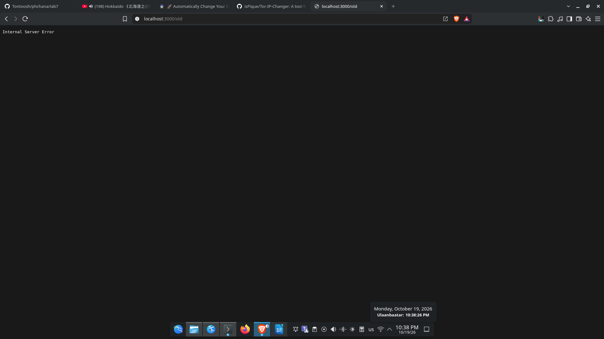

Серверийг шинээр асаасны дараах зураг:

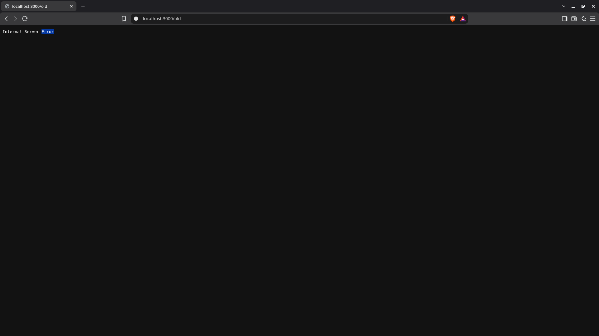

## BUG-09 — Буруу JSON-д HTTP 400-ийн оронд 200 буцаана

**22:41:25, анхны туршилт:** Буруу JSON илгээх оролдлогын гаралт `evidence/invalid-json-curl.txt` файлд хадгалагдсан. Анхны терминалын зурагт curl URL-ийн алдаа байсан тул зөв командаар дахин баталгаажуулсан. Аялал: Saboteur.

Давтан ажиллуулсан команд:

```bash
curl -sS -i -X POST http://localhost:3000/api/books \
  -H 'Content-Type: application/json' \
  --data-binary '{"title":'
```

Хүлээгдсэн: Буруу JSON биетэй POST хүсэлтэд HTTP 400.

**22:55:53, зассан командаар шалгасан үр дүн:** `HTTP/1.1 200 OK`, `{"result":"OK"}`.

**23:14:37, шинээр асаасан серверийн үр дүн:** Мөн HTTP 200 болон `{"result":"OK"}` буцсан. API нотолгоог скриншотын оронд статусын мөр, header, body бүхий текстээр хадгалсан.

- [Анхны session-ийн HTTP гаралт](evidence/invalid-json-curl.txt).
- [Зөв командаар дахин баталсан HTTP гаралт](evidence/bug-09-curl.txt).
- [Шинэ clone, шинээр асаасан серверийн HTTP гаралт](evidence/clone-invalid-json-curl.txt).
- [Дэлгэрэнгүй тайлан](bugs/bug-09.md).

## Саадууд (issues)

- Wayland орчинд scrot хар зураг авсан тул KDE Spectacle ашиглаж, Brave-ийн тусдаа туршилтын цонхноос зураг авсан.
- GUI удирдлагын keyboard layout/focus-оос URL болон талбар буруу орсон оролдлогуудыг зөв тестийн үр дүнд тооцоогүй; URL-ийг clipboard-оор оруулж, талбаруудыг тусад нь шалгаад давтсан.
- Анхны curl командын URL алдааг зөв командаар дахин шалгаж залруулсан; хуучин нотолгоог өөрчлөөгүй.
- Анхны BUG тэмдэглэлд цаг бичээгүй байсан тул зураг, HTTP Date-ийн цагийг тайлан боловсруулах үед холбосон.
- Session-ийн дуусах цагийг эхэндээ бүртгээгүй байсан; дараа нь тестер нийт 60 минут ажилласнаа мэдээлсэн тул хугацааг шинэчилсэн. Үе шатны хувийг ойролцоогоор тэмдэглэсэн.

## Дахин шалгалтын дүн

Аппын эх кодыг уншихгүйгээр Brave дээр UI үйлдэл, curl -i-ийн HTTP хариугаар шалгасан. UI-ийн 8 тайлангийн үндсэн үр дүн болон API-ийн 1 согог давтагдсан. Анхны хувилбарын баримтаас гадна шинэ clone хавтаснаас ажиллуулсан серверийн баримтуудыг хадгалсан. Хоосон гарчиг, зохиолч, оныг нэг заавал бөглөх шалгалтын согог болгон BUG-02-т нэгтгэж, оны харагдах форматыг BUG-04-т тусад нь ялгасан. [Дахин шалгалтын үеэр цагтай бичсэн бүрэн түүхий тэмдэглэл](evidence/verification-notes.md).

## Цагийн задаргаа

Үе шат тус бүрийг тусдаа таймераар хэмжээгүй тул задаргааг ойролцоогоор тэмдэглэв. Verified давталт нь согогийг судалж баталгаажуулах хэсэгт багтана.

| Үе шат | Ойролцоо хувь |
|---|---|
| Setup | 4% |
| Тест дизайн ба гүйцэтгэл | 31% |
| Согог судлах ба баталгаажуулах | 65% |
| **Нийт** | **100%** |

Setup ойролцоогоор 4% · Тест дизайн ба гүйцэтгэл ойролцоогоор 31% · Согог судлах ба баталгаажуулах ойролцоогоор 65%.

## Үлдсэн зүйл

1. GitHub-д шинэ commit-уудыг push хийнэ: өмнөх оролдлого HTTPS нэвтрэлт олдоогүй тул амжилтгүй болсон.
2. GitHub дээр зургууд харагдаж байгааг шалгаж, public репогийн үндсэн линкийг Teams Assignment-д хугацаанд нь Turn in хийнэ.
